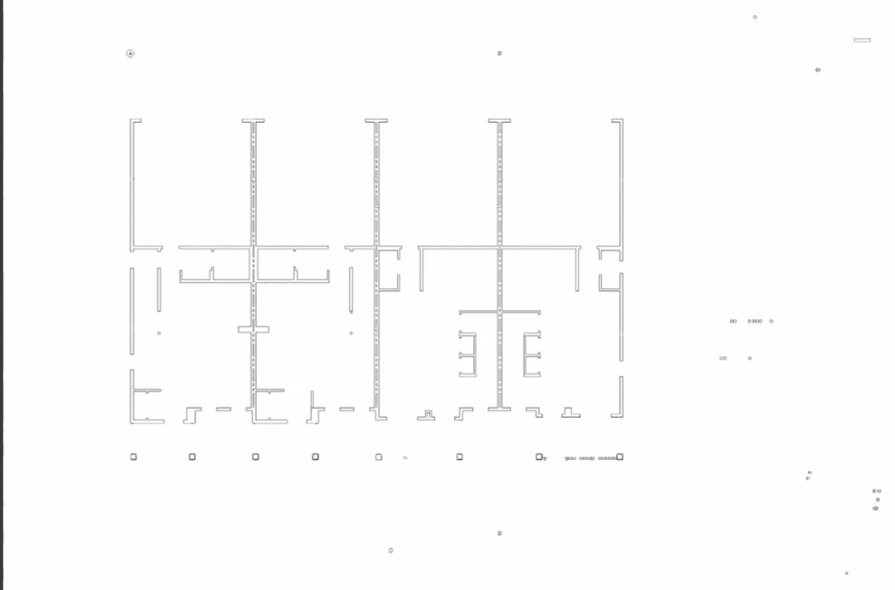
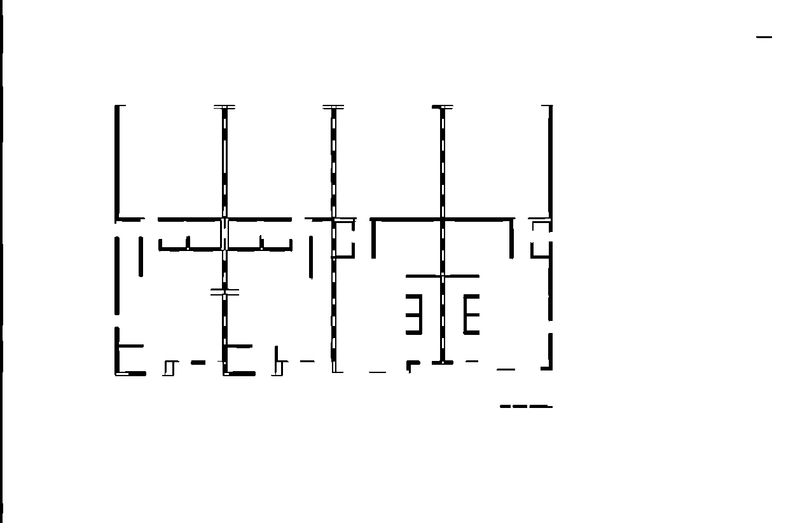
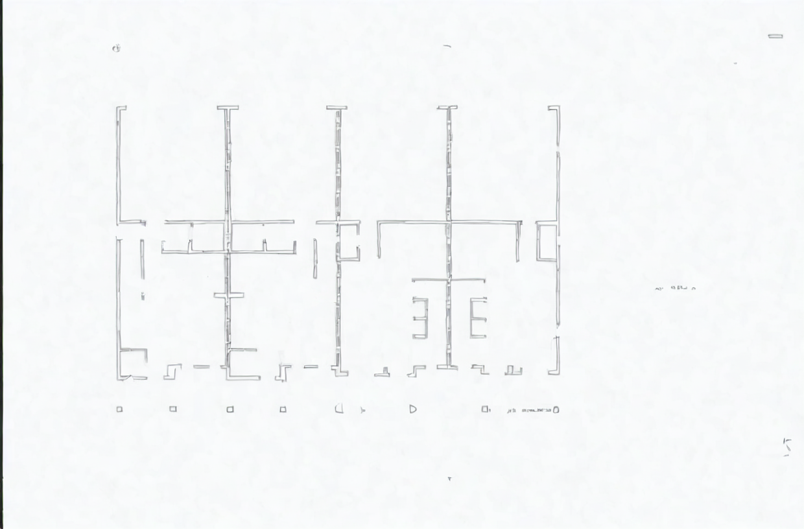
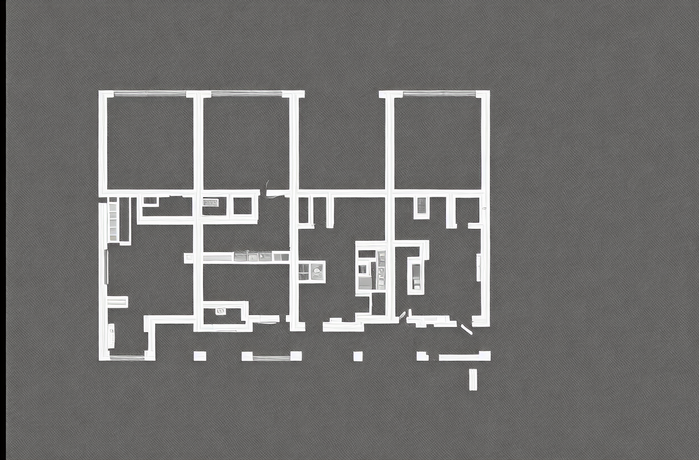

# Multimodal LLMs Applications

Experiments applying vision models and multimodal LLMs to industrial problems:

| Module | Task | Methods |
|---|---|---|
| [`src/image_proc`](src/image_proc) | Extract walls from architectural floorplans | OpenCV morphology, Stable Diffusion img2img, ControlNet |
| [`src/ocr`](src/ocr) | OCR with word-level positions | Tesseract |
| [`src/vlms`](src/vlms) | Read room names, dimensions and materials from blueprints as JSON | GPT-4o, Qwen2.5-VL-3B, LayoutLMv3, Donut |
| [`src/time_series_vision`](src/time_series_vision) | Forecast time series (GRACE groundwater) by treating them as images | VisionTS, ViT-B/16 |

> Status: research sandbox. Scripts are standalone and run from the repo root.
> `gan_filer.py`, `vision_ts.py` and `tip_model.py` are placeholders.

---

## 1. Floorplan wall extraction

**Goal:** keep only the walls of a floorplan and drop text, symbols, dimension marks and noise.

### a) Classical filtering — [`filtering.py`](src/image_proc/filtering.py)

1. **Adaptive threshold.** Each pixel is compared with the mean of its $31\times31$ neighbourhood $\mathcal{N}$, so faint thin lines survive uneven lighting:

$$
B(x,y) = \begin{cases} 255 & I(x,y) < \mu_{\mathcal{N}}(x,y) - C \\ 0 & \text{otherwise} \end{cases}, \qquad C = 5
$$

2. **Line-preserving opening.** Opening with long, thin kernels keeps only straight horizontal and vertical strokes (walls) and removes text:

$$
W = (B \circ K_{1\times15}) \;\lor\; (B \circ K_{15\times1}), \qquad B \circ K = (B \ominus K) \oplus K
$$

3. **Connected-component filter.** Components with area $\le 50$ px, or smaller than 5 px in both width and height, are removed.
4. A $3\times3$ closing smooths the result.

### b) Diffusion cleanup — [`diffusion_filtering.py`](src/image_proc/diffusion_filtering.py)

Stable Diffusion 1.5 img2img (SDEdit). The input is only partly noised, to step $t = s \cdot T$, and then denoised toward the prompt *"clean architectural floorplan, thin black walls on white background, no text"*:

$$
x_t = \sqrt{\bar\alpha_t}\,x_0 + \sqrt{1-\bar\alpha_t}\,\epsilon, \qquad \epsilon \sim \mathcal{N}(0, I)
$$

Prompt adherence comes from classifier-free guidance with $w = 7$:

$$
\hat\epsilon = \epsilon_\theta(x_t, \varnothing) + w\big(\epsilon_\theta(x_t, c) - \epsilon_\theta(x_t, \varnothing)\big)
$$

The **strength** $s$ is the main trade-off. A low value ($s = 0.25$) keeps the geometry, and a high value lets the model invent structure. A ControlNet line-art variant is included in the file, commented out. Requires a CUDA GPU.

### Results

| Input | OpenCV (`walls_only.png`) |
|---|---|
|  |  |

| SD img2img, $s=0.25$ (`walls_diffusion_refined.png`) | ControlNet line-art (`walls_diffusion_clean.png`) |
|---|---|
|  |  |

**Observations**
- **OpenCV works best.** It removes the noise and annotations around the plan and keeps the full wall layout. It is fast, deterministic and needs no GPU. The main flaw is that hollow double-line walls come out as dashed strokes.
- **SD img2img at low strength** keeps the geometry and removes most of the annotations, but leaves a faint texture over the background and the walls stay thin outlines. It would need thresholding afterwards.
- **ControlNet hallucinates.** It adds rooms, furniture and walls that are not in the input, and inverts the colours. It is not usable for measurement; this is a cautionary example.

---

## 2. Layout-aware OCR — [`ocr_spatial.py`](src/ocr/ocr_spatial.py)

Runs Tesseract on `results/ocr/sample_doc.png` twice:
- `image_to_string` returns the plain text;
- `image_to_data` returns every word with its bounding box $(x, y, w, h)$.

The boxes are drawn to `results/ocr/layout_aware_output.png`. The coordinates can be passed to layout-aware models such as LayoutLMv3.

---

## 3. Blueprint dimension extraction with VLMs — [`vlm_dim_extract.py`](src/vlms/vlm_dim_extract.py)

Each model reads `results/blueprints/floorplan3.jpg` and is asked for the same output:

```json
{ "rooms": [{"name": "...", "dimensions": "..."}],
  "materials": [{"element": "...", "type": "..."}] }
```

| Model | Type | Runs |
|---|---|---|
| GPT-4o | General multimodal LLM | OpenAI API |
| Qwen2.5-VL-3B-Instruct | Open vision-language model | Local (Hugging Face) |
| LayoutLMv3 | Text + layout + image document model, extractive question answering | Local |
| Donut | OCR-free document model (DocVQA fine-tune) | Local |

For GPT-4o, replace the placeholder `openai_api_key` in the script with your key, or better, change it to read the `OPENAI_API_KEY` environment variable.

---

## 4. Time series as images — [`src/time_series_vision`](src/time_series_vision)

**Idea (VisionTS):** a masked autoencoder pretrained on natural images can forecast time series without any time-series training, if the series is reshaped into an image.

A 12-month series $s \in \mathbb{R}^{12}$ becomes a $3\times4$ grid, is min-max normalised and copied to 3 channels:

$$
\tilde s = \frac{s - \min s}{\max s - \min s + \varepsilon}, \qquad X = \operatorname{stack}_3\big(\operatorname{reshape}_{3\times4}(\tilde s)\big)
$$

The frozen encoder output is averaged into one feature vector, and only a small MLP head on top is trained with MSE loss:

$$
z = \operatorname{GAP}\big(f_{\text{VisionTS}}(X)\big) \in \mathbb{R}^{768}, \qquad \hat y = \operatorname{MLP}(z), \qquad \mathcal{L} = \tfrac{1}{N}\sum_i (\hat y_i - y_i)^2
$$

- [`vision_st.py`](src/time_series_vision/vision_st.py) trains this single-input forecaster.
- [`vistionst_2.py`](src/time_series_vision/vistionst_2.py) is a groundwater predictor that combines three inputs before the head:

$$
x = \big[\, z_{\text{GRACE}} \;\|\; z_{\text{ViT}}(\text{satellite patch}) \;\|\; \text{DEM/rainfall} \,\big]
$$

Here $\|$ means concatenation.

> Both scripts currently run on **random mock data**, so their loss values are not meaningful results. They need the [VisionTS repo](https://github.com/Keytoyze/VisionTS) cloned into `VisionTS/` and a checkpoint at `VisionTS/checkpoints/visionts_base.pth`.

---

## Setup

```bash
pip install opencv-python numpy pillow pytesseract           # filtering + OCR (also: brew/apt install tesseract)
pip install torch torchvision diffusers transformers accelerate safetensors   # diffusion + VLMs
pip install openai bitsandbytes                              # GPT-4o, quantised loading
git clone https://github.com/Keytoyze/VisionTS.git && pip install -e VisionTS   # time series
```

Run any script from the repo root, for example:

```bash
python src/image_proc/filtering.py
```

---

## References

1. R. Smith. *An Overview of the Tesseract OCR Engine.* ICDAR 2007.
2. R. Rombach et al. *High-Resolution Image Synthesis with Latent Diffusion Models.* CVPR 2022.
3. C. Meng et al. *SDEdit: Guided Image Synthesis and Editing with Stochastic Differential Equations.* ICLR 2022.
4. J. Ho, T. Salimans. *Classifier-Free Diffusion Guidance.* arXiv:2207.12598, 2022.
5. L. Zhang, A. Rao, M. Agrawala. *Adding Conditional Control to Text-to-Image Diffusion Models (ControlNet).* ICCV 2023.
6. OpenAI. *GPT-4o System Card.* arXiv:2410.21276, 2024.
7. S. Bai et al. *Qwen2.5-VL Technical Report.* arXiv:2502.13923, 2025.
8. Y. Huang et al. *LayoutLMv3: Pre-training for Document AI with Unified Text and Image Masking.* ACM MM 2022.
9. G. Kim et al. *OCR-free Document Understanding Transformer (Donut).* ECCV 2022.
10. M. Chen et al. *VisionTS: Visual Masked Autoencoders Are Free-Lunch Zero-Shot Time Series Forecasters.* arXiv:2408.17253, 2024.
11. K. He et al. *Masked Autoencoders Are Scalable Vision Learners.* CVPR 2022.
12. A. Dosovitskiy et al. *An Image is Worth 16x16 Words: Transformers for Image Recognition at Scale (ViT).* ICLR 2021.
13. B. Tapley et al. *GRACE Measurements of Mass Variability in the Earth System.* Science 305, 2004.

## License

MIT — see [LICENSE](LICENSE).
